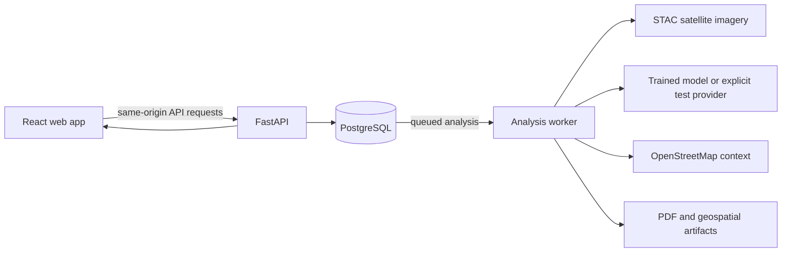

# FloodSight AI

FloodSight AI is a web application for exploring potential flood extent from satellite radar imagery. It lets an analyst define an area and event date, queue an analysis, inspect the returned map and measurements, and download a situation report.

> **Interpret results carefully.** A trained model produces predictions, not confirmed ground truth. The development-only `synthetic_test` provider produces labelled test patterns, not flood predictions. OpenStreetMap intersections indicate possible exposure; they do not confirm damage.

## Contents

- [Features](#features)
- [How it works](#how-it-works)
- [Technology](#technology)
- [Requirements](#requirements)
- [Run locally](#run-locally)
- [Use a trained model](#use-a-trained-model)
- [Build and preview the frontend](#build-and-preview-the-frontend)
- [Data and persistence](#data-and-persistence)
- [API and health checks](#api-and-health-checks)
- [Troubleshooting](#troubleshooting)
- [Tests](#tests)
- [More documentation](#more-documentation)

## Features

- Search for a location or draw an area of interest on the map.
- Submit an analysis for an event date and follow its processing status.
- Review flood extent maps, measurements, provenance, warnings, and available exposure context.
- Open a generated PDF situation report and download supported geospatial artifacts.
- Register and sign in with a server-managed session.
- Choose a light or dark workspace theme and save profile display details on the current browser.

## How it works



The API records an analysis and queues a job in PostgreSQL. A separate worker acquires and prepares imagery, runs the configured prediction provider, stores results and artifacts, and marks the job complete or failed. The browser reads its status and displays data returned by the backend; it does not invent flood measurements or map layers.

## Technology

| Area | Main components |
| --- | --- |
| Web app | React, React Router, MapLibre GL JS, plain CSS |
| Build and local server | Node.js, esbuild, `build.mjs` |
| API | FastAPI, Pydantic, SQLAlchemy, Alembic |
| Data and jobs | PostgreSQL |
| Geospatial processing | Rasterio, Shapely, GeoPandas, NumPy, SciPy |
| Prediction | PyTorch and the FloodSight model repository |

## Requirements

- Node.js 20 or later and npm
- Python 3.12
- Docker Desktop or Docker Engine with Compose, for local PostgreSQL
- Internet access for satellite catalogue, location search, and map tiles
- Trained model repository and checkpoint for real model predictions (optional for local UI and synthetic pipeline development)

## Run locally

These steps run PostgreSQL in Docker and the API, worker, and frontend as local processes. They are written for PowerShell; equivalent activation and copy commands for macOS/Linux are included below.

### 1. Start the database and install backend dependencies

From the repository root:

```powershell
docker compose up -d postgres
py -3.12 -m venv .venv
.\.venv\Scripts\Activate.ps1
python -m pip install -r backend/requirements.txt
Copy-Item backend/.env.example backend/.env
```

Edit `backend/.env` and set `PREDICTION_PROVIDER=synthetic_test` if you do not have a trained checkpoint. This mode is only for development and pipeline testing; its output is explicitly labelled synthetic and is not a flood prediction. The default is `trained_model`.

### 2. Apply migrations and start the API

In a terminal at the repository root:

```powershell
.\.venv\Scripts\Activate.ps1
Set-Location backend
alembic upgrade head
uvicorn app.main:app --reload
```

The API is available at `http://127.0.0.1:8000`; interactive API docs are at `http://127.0.0.1:8000/docs`.

### 3. Start the worker

In a second terminal at the repository root:

```powershell
.\.venv\Scripts\Activate.ps1
Set-Location backend
python -m app.workers.analysis_worker
```

The worker is required to process queued analyses. Without it, new jobs remain queued.

### 4. Start the frontend

In a third terminal at the repository root:

```powershell
npm ci
npm run dev
```

Open `http://localhost:3000`. The development server proxies `/api` and `/health` to `http://127.0.0.1:8000`, including the session cookie. Create an account from the sign-up page.

### macOS/Linux command equivalents

```bash
docker compose up -d postgres
python3.12 -m venv .venv
source .venv/bin/activate
python -m pip install -r backend/requirements.txt
cp backend/.env.example backend/.env
# Edit backend/.env and set PREDICTION_PROVIDER=synthetic_test when no trained checkpoint is available.

cd backend
alembic upgrade head
uvicorn app.main:app --reload
```

Run the worker in another terminal with `source .venv/bin/activate`, `cd backend`, then `python -m app.workers.analysis_worker`. Run the frontend from the repository root with `npm ci` and `npm run dev`.

## Use a trained model

The FloodSight model implementation and trained weights are not bundled in this repository. The backend expects the model repository at `MODEL_REPO_PATH` and a compatible checkpoint at `MODEL_PATH`. See [the backend model setup guide](backend/README.md#model-setup) for the model contract and checkpoint fields.

Set these values in `backend/.env`, then restart the API and worker:

```dotenv
PREDICTION_PROVIDER=trained_model
MODEL_REPO_PATH=../multimodal-ai
MODEL_PATH=../multimodal-ai/checkpoints/best.pt
MODEL_DEVICE=auto
```

The model repository must contain the expected architecture and the checkpoint must match its documented input and normalization contract. Check provider readiness at `/health/model`. Missing or incompatible weights are reported as unavailable; the backend does not silently substitute synthetic output.

For pipeline development without weights, use `PREDICTION_PROVIDER=synthetic_test` in a development environment. Synthetic mode is refused in production unless explicitly overridden by a separate production setting; it must not be used for flood response or decision-making.

## Build and preview the frontend

```bash
npm run build
npm run preview
```

The production files are written to `dist/`. The preview server listens on `http://localhost:4173` and proxies API requests to `http://127.0.0.1:8000` by default. Set `FLOODSIGHT_API_PROXY` to change the preview/dev server's backend target.

For a separately hosted frontend, configure a reverse proxy for `/api` and `/health`, or define `window.FLOODSIGHT_API_BASE_URL` before the app bundle loads. Configure the backend's `CORS_ALLOW_ORIGINS` when the frontend and API use different origins. Use HTTPS and matching cookie settings in production.

## Data and persistence

- User accounts, sessions, analysis records, job state, and analysis results are stored by the backend in PostgreSQL.
- Generated PDFs, GeoJSON, and raster artifacts are stored under `ARTIFACT_ROOT`; Docker Compose uses a persistent volume for artifacts and another for PostgreSQL.
- Workspace theme and profile display details are saved in the current browser's local storage. They are not synced to an account or another device.
- The active analysis ID is kept in session storage to restore the current results view after a page reload. It is not an authentication credential.
- Authentication uses an HttpOnly session cookie. Passwords are hashed by the backend; session tokens are not exposed to frontend JavaScript.

## API and health checks

The full API reference is available at `http://127.0.0.1:8000/docs` when the API is running. Useful health routes are:

| Route | What it checks |
| --- | --- |
| `/health/live` | API process is running |
| `/health/ready` | Database connection is ready |
| `/health/model` | Configured prediction provider readiness |
| `/health/ready/capabilities` | Whether the API can accept new analyses |

An accepted analysis request means the job was recorded; it does not mean processing succeeded. Follow the job status through a terminal state before relying on results.

## Troubleshooting

| Symptom | Check |
| --- | --- |
| Frontend says it cannot reach the analysis service | Start the API and confirm `http://127.0.0.1:8000/health/live` responds. Check `FLOODSIGHT_API_PROXY` if you changed the backend port. |
| Jobs stay queued | Start the analysis worker and check its terminal output. |
| API readiness is unavailable | Confirm PostgreSQL is running with `docker compose ps`, then check `DATABASE_URL` and run `alembic upgrade head` from `backend/`. |
| Model is unavailable | Check `/health/model`, `MODEL_REPO_PATH`, `MODEL_PATH`, and the checkpoint contract. Use the explicit synthetic provider only for development. |
| Location search or map is blank/slow | Confirm internet access and check browser DevTools for blocked geocoding or tile requests. |
| Report is not available | Wait for the analysis to complete and check the worker logs and `ARTIFACT_ROOT` permissions. |

## Tests

Frontend checks build the app and run Node's test runner:

```bash
npm test
```

Backend tests require the development test dependencies and a dedicated test database. They recreate the test schema, so do not point `TEST_DATABASE_URL` at your development database. Setup and the exact command are documented in [`backend/README.md`](backend/README.md#tests).

## More documentation

- [Backend architecture, configuration, API, and processing details](backend/README.md)
- [Production deployment](docs/deployment/production-deployment.md)
- [Deployment readiness](docs/validation/deployment-readiness.md)
- [Model architecture and training resources](multimodal-ai/README.md)

